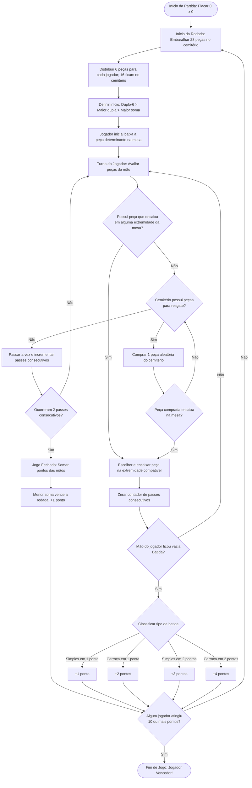

# Desafio de Testes: Dominó (`desafio_teste_domino`)

## 1. Especificação e Requisitos de Entrega

* **Objetivo do Desafio:** Desenvolver uma suíte de casos de teste automatizados em **JavaScript** para validar as regras e o fluxo de uma partida de **Dominó para 2 jogadores**, testando uma implementação também escrita em **JavaScript**.
* **Prazo de Entrega:** Até **22/11/2026**.
* **Formato de Trabalho:** Individual ou em dupla. Caso seja em dupla, ambos os integrantes devem possuir contribuições (commits) rastreadas no histórico do repositório; caso contrário, apenas quem contribuiu será avaliado.
* **Repositório Obrigatório:** O nome do repositório deve ser exatamente `desafio_teste_domino`.
* **Link de Entrega:** [Formulário Oficial de Entrega](https://forms.gle/bgbV2TwrreR8LiAGA)
* **Requisitos Obrigatórios do `README.md`:**
  1. Identificação da especificação do desafio;
  2. Explicação clara do funcionamento e execução dos casos de teste;
  3. Identificação completa do(s) colaborador(es).

---

## 2. Regras Base do Jogo (2 Jogadores)

### 2.1. Peças e Preparação
* **Conjunto de Peças:** O jogo utiliza **28 peças** retangulares únicas, divididas ao meio com valores de `0` (branco) a `6` (sena) em cada extremidade (de `[0|0]` até `[6|6]`).
* **Cemitério e Distribuição:** As 28 peças são embaralhadas viradas para baixo (formando o **cemitério**). Cada um dos **2 jogadores** compra **6 peças** iniciais ($2 \times 6 = 12$ peças distribuídas), restando **$28 - 12 = 16$ peças** no cemitério.

### 2.2. Ordem de Início
A primeira jogada da rodada é determinada pela mão inicial dos jogadores, seguindo esta hierarquia:
1. Inicia quem possuir o **duplo-6 (`[6|6]`)** (carroça de sena);
2. Caso ninguém tenha o `[6|6]`, inicia quem possuir a **maior peça dupla** (`[5|5]`, `[4|4]`, `[3|3]`, `[2|2]`, `[1|1]`, `[0|0]`);
3. Caso nenhum jogador possua peças duplas, inicia quem tiver a **peça de maior soma** (ex.: `[6|5]`, que soma $11$ pontos).

### 2.3. Dinâmica de Turno, Encaixe e Cemitério
* **Alternância:** Os turnos alternam entre os 2 jogadores (sentido horário).
* **Encaixe na Mesa:** Na sua vez, o jogador deve baixar uma peça da sua mão em uma das **duas extremidades** abertas da cadeia na mesa, desde que um dos lados da peça tenha o mesmo número da extremidade escolhida.
* **Resgate de Peças do Cemitério / Passar a Vez:**
  * Se o jogador **não possuir** nenhuma peça que encaixe nas extremidades da mesa, ele deve comprar peças aleatórias do **cemitério**, uma por uma, até encontrar uma peça que encaixe (acumulando as peças compradas em sua mão).
  * Caso o cemitério esvazie sem que o jogador encontre uma peça compatível (ou caso o modo de jogo esteja configurado sem resgate), o jogador **passa a vez**.

### 2.4. Encerramento da Rodada e Pontuação da Partida
A partida é disputada em rodadas sucessivas até que um dos jogadores atinja **10 ou mais pontos** ($\ge 10$). Uma rodada termina de duas formas:

1. **Batida (Mão Vazia):** O jogador baixa todas as peças de sua mão. A pontuação ganha depende da forma da batida:
   * **Batida normal** (em uma única ponta, com peça simples): **1 ponto**;
   * **Batida de carroça** (peça dupla, ex.: `[6|6]`, em uma única ponta): **2 pontos**;
   * **Batida em duas pontas de uma vez** (com peça simples encaixando simultaneamente nas duas extremidades): **3 pontos**;
   * **Batida de carroça em duas pontas de uma vez**: **4 pontos**.
2. **Jogo Fechado (Trancado):** Nenhum dos 2 jogadores consegue jogar (ambos passam a vez consecutivamente e não há peças disponíveis no cemitério).
   * Cada jogador soma os valores das duas pontas de todas as peças restantes em sua mão.
   * Vence a rodada quem possuir **menos pontos** na mão, recebendo **1 ponto** no placar geral.

---

## 3. Validação das Regras e Casos de Borda (Edge Cases)

Antes de implementar os testes em JavaScript, foram validadas as seguintes regras e ambiguidades potenciais da especificação:

1. **Mão Inicial de 6 Peças (e não 7):** Embora algumas variantes comerciais distribuam 7 peças para 2 jogadores, a especificação oficial deste desafio determina explicitamente **6 peças por jogador**, deixando **16 peças** no cemitério. Os testes devem validar `mao.length === 6` e `cemiterio.length === 16` após a distribuição.
2. **Integração entre "Passar a Vez" e "Resgate do Cemitério":** A especificação apresenta a passagem de vez quando não há encaixe e detalha o modo de resgate no cemitério. Para evitar um loop infinito quando o jogador não tem peça válida e o monte acaba, a regra validada estabelece que o jogador **compra do cemitério enquanto houver peças**; se o cemitério chegar a $0$ peças e nenhuma encaixar, ele **passa a vez**.
3. **Condição Exata de Jogo Fechado:** Um jogo só é considerado **fechado** quando ocorrem **2 passes consecutivos** (Jogador A passa e Jogador B passa na sequência, com o cemitério vazio). Se um jogador passa porque o cemitério acabou, mas o adversário ainda consegue jogar e reabre uma ponta, o jogo continua normalmente.
4. **Critérios de Desempate (Início e Jogo Fechado):**
   * *No início da rodada:* Caso nenhum jogador tenha peças duplas e haja empate na maior soma (ex.: `[6|3]` $= 9$ pontos contra `[5|4]` $= 9$ pontos), o desempate ocorre pela peça que contiver o **maior número individual** ($6 > 5$).
   * *No jogo fechado:* Caso ambos os jogadores terminem com exatamente a mesma soma de pontos na mão, a rodada termina empatada ($0$ pontos para ambos) ou vence quem realizou a última jogada antes do travamento (deve ser validado de forma determinística no motor do jogo).
5. **Mecânica da "Batida em Duas Pontas" (3 e 4 pontos):** Ocorre quando a última peça da mão do jogador é compatível com **ambas as extremidades abertas da mesa simultaneamente** (por exemplo, a mesa apresenta pontas `2` e `5` e o jogador bate com `[2|5]` para **3 pontos**, ou a mesa apresenta pontas `4` e `4` e o jogador bate com a carroça `[4|4]` para **4 pontos**).

---

## 4. Diagrama do Fluxo de Jogo

---

## 5. Matriz de Casos de Teste (JavaScript)

A estrutura abaixo serve de guia para a organização das suítes (`describe`) e casos de teste (`it`/`test`) no repositório `desafio_teste_domino`:

| Suíte de Teste (`describe`) | Caso de Teste (`it`) | Cenário / Entrada | Resultado Esperado |
| :--- | :--- | :--- | :--- |
| **1. Preparação e Distribuição** | Deve gerar baralho completo de dominó | Inicializar conjunto de peças | 28 peças únicas de `[0\|0]` a `[6\|6]`, sem duplicatas |
| **1. Preparação e Distribuição** | Deve distribuir mãos iniciais corretamente | Iniciar rodada para 2 jogadores | Jogador 1 com 6 peças, Jogador 2 com 6 peças e cemitério com 16 peças |
| **2. Definição de Início** | Deve iniciar quem possui o duplo-6 | J1 tem `[6\|6]`; J2 tem `[5\|5]` e `[6\|5]` | Jogador 1 é escolhido e inicia baixando `[6\|6]` |
| **2. Definição de Início** | Deve iniciar pela maior dupla na ausência do duplo-6 | Sem `[6\|6]`; J1 tem `[2\|2]`, J2 tem `[4\|4]` | Jogador 2 é escolhido e inicia baixando `[4\|4]` |
| **2. Definição de Início** | Deve iniciar pela maior soma quando não há duplas | Sem duplas; J1 tem `[6\|4]` (10), J2 tem `[6\|5]` (11) | Jogador 2 é escolhido e inicia baixando `[6\|5]` |
| **3. Encaixe e Movimentação** | Deve encaixar peça compatível e atualizar extremidade | Mesa com pontas `6` e `4`; jogador baixa `[4\|2]` na ponta `4` | Peça aceita; novas extremidades da mesa passam a ser `6` e `2` |
| **3. Encaixe e Movimentação** | Deve rejeitar jogada com peça incompatível | Mesa com pontas `6` e `2`; jogador tenta baixar `[5\|3]` | Jogada bloqueada/erro lançado; estado da mesa e mão inalterados |
| **4. Cemitério e Passagem de Vez** | Deve comprar do cemitério até encontrar peça válida | Mesa `6` e `2`; mão sem `6` ou `2`; 3ª peça do monte é `[2\|1]` | Jogador compra 3 peças (fica com +2 na mão) e baixa `[2\|1]` |
| **4. Cemitério e Passagem de Vez** | Deve passar a vez se cemitério esvaziar sem peça válida | Mão sem encaixe e cemitério com 1 peça inválida | Jogador compra a última peça, não encaixa e passa a vez |
| **5. Pontuação da Rodada** | Deve atribuir 1 ponto para batida simples | Jogador baixa última peça simples em uma única extremidade | Rodada encerra; vencedor recebe `+1` ponto |
| **5. Pontuação da Rodada** | Deve atribuir 2 pontos para batida de carroça | Jogador baixa última peça dupla (ex.: `[3\|3]`) em 1 ponta | Rodada encerra; vencedor recebe `+2` pontos |
| **5. Pontuação da Rodada** | Deve atribuir 3 pontos para batida simples em 2 pontas | Mesa com pontas `2` e `5`; jogador bate com `[2\|5]` | Rodada encerra; vencedor recebe `+3` pontos |
| **5. Pontuação da Rodada** | Deve atribuir 4 pontos para batida de carroça em 2 pontas | Mesa com pontas `4` e `4`; jogador bate com `[4\|4]` | Rodada encerra; vencedor recebe `+4` pontos |
| **5. Pontuação da Rodada** | Deve encerrar por jogo fechado e premiar menor soma | Cemitério vazio; J1 e J2 passam; J1 soma 4 pts, J2 soma 9 pts | Rodada encerra por trancamento; J1 vence e ganha `+1` ponto |
| **6. Vitória da Partida** | Deve iniciar nova rodada enquanto placar for menor que 10 | Jogador vence rodada e vai de 7 para 9 pontos | Placar atualizado para 9; nova rodada é iniciada com 28 peças |
| **6. Vitória da Partida** | Deve finalizar partida ao atingir 10 ou mais pontos | Jogador com 8 pontos faz batida de carroça (`+2` pontos) | Placar atinge 10 pontos; partida encerra declarando o vencedor |